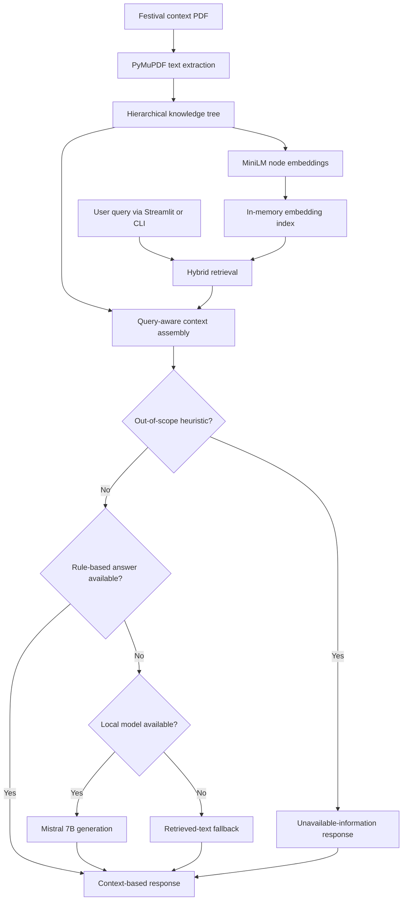

# Shaastra 2026 Bot

**Hierarchical RAG · Hybrid Retrieval · Local LLM Inference**

   

An independently developed question-answering assistant for Shaastra 2026, the annual technical festival of IIT Madras. It converts a festival context PDF into a hierarchical knowledge tree and retrieves relevant information about events, competitions, workshops, lectures, speakers, schedules and venues.

## Problem and approach

Finding specific event information in a long festival document can require repeated manual searches. This project explores a natural-language interface that combines structured document parsing, semantic retrieval, lexical matching and local language-model inference.

## Key features

- **Hierarchical knowledge representation:** Root, category, item and detail nodes preserve relationships between events and their attributes.
- **Hybrid retrieval:** Combines embedding similarity with keyword overlap and event-name matching.
- **Query-aware context selection:** Handles named events, date-based event lists, general festival questions and selected speaker or schedule queries.
- **Hybrid answer generation:** Prioritizes deterministic extraction and formatting before invoking the language model.
- **Local inference:** Uses Mistral 7B Instruct through CTransformers without requiring a hosted LLM API.
- **Retrieval-only fallback:** Returns extracted information when the local GGUF model is absent.
- **Two interfaces:** Streamlit chat dashboard and command-line interface.

## System architecture



### Knowledge representation

```text
Shaastra 2026 (root)
└── Category
    └── Event or item
        ├── Description
        ├── Date
        ├── Time
        └── Venue
```

The parser uses document-specific headings, detail fields and schedule extraction rules to build and enrich the tree. The structure above is illustrative; individual nodes can contain different attributes.

### Retrieval methodology

The system encodes node text and the user query using `sentence-transformers/all-MiniLM-L6-v2`. The ranking score combines cosine similarity and lexical relevance:

```text
score = cosine_similarity + 0.20 × lexical_score
lexical_score = query_term_overlap + exact_name_bonus + compact_name_bonus
```

The default retrieval selects the top three ranked nodes. Detail-node matches are mapped to their parent items, and repeated context blocks are removed. Query-specific rules can select relevant tree nodes directly rather than relying exclusively on the ranked results.

### Answer generation

The answer pipeline checks out-of-scope heuristics, applies event-specific extraction and formatting rules, and handles long contexts. If those rules do not produce an answer, the local Mistral model generates a response using the selected context. When the model is absent, a simpler text-based fallback is used instead.

## Technology stack

| Layer | Technology |
| --- | --- |
| Language | Python |
| PDF processing | PyMuPDF |
| Knowledge representation | Custom Python tree structures |
| Embeddings | Sentence Transformers / all-MiniLM-L6-v2 |
| Retrieval | NumPy, scikit-learn cosine similarity, lexical scoring |
| Language model | Mistral 7B Instruct v0.2, Q4_K_M GGUF |
| Inference | CTransformers |
| Interface | Streamlit, CLI |

## Repository structure

```text
shaastra-2026-bot/
├── app.py                    # Parsing, indexing, retrieval, generation and CLI
├── dashboard.py              # Streamlit chat interface
├── shaastra_contextdoc.pdf    # Festival knowledge source
├── requirements.txt          # Python dependencies
├── .gitignore
└── README.md
```

## Getting started

Python 3.11 is suggested. The dependencies are not version-pinned, so compatibility with newer package releases may vary.

### 1. Clone and install

```bash
git clone https://github.com/manushri250/shaastra-2026-bot.git
cd shaastra-2026-bot
python -m venv .venv
```

Activate the environment on Windows PowerShell:

```powershell
.\.venv\Scripts\Activate.ps1
```

On macOS or Linux:

```bash
source .venv/bin/activate
```

Install the dependencies:

```bash
python -m pip install -r requirements.txt
```

### 2. Configure the optional local LLM

Download [`mistral-7b-instruct-v0.2.Q4_K_M.gguf`](https://huggingface.co/TheBloke/Mistral-7B-Instruct-v0.2-GGUF/resolve/main/mistral-7b-instruct-v0.2.Q4_K_M.gguf) from the [model repository](https://huggingface.co/TheBloke/Mistral-7B-Instruct-v0.2-GGUF) and place it at:

```text
models/mistral-7b-instruct-v0.2.Q4_K_M.gguf
```

The weights are not included in Git. The embedding model may also require an initial download. Sufficient disk space and memory are needed for local inference. The application can use its retrieval-only fallback if the GGUF file is absent.

### 3. Launch the application

```bash
python -m streamlit run dashboard.py
```

Open `http://localhost:8501` in your browser.

Alternatively, use the CLI:

```bash
python app.py
```

### Configuration

| Environment variable | Default |
| --- | --- |
| `PDF_PATH` | `shaastra_contextdoc.pdf` |
| `LLM_MODEL_PATH` | `models/mistral-7b-instruct-v0.2.Q4_K_M.gguf` |
| `EMBEDDING_MODEL` | `sentence-transformers/all-MiniLM-L6-v2` |

## Example queries

These are example inputs provided by the original dashboard, not verified benchmark results:

- What events are on January 4?
- Where is Robowars held?
- Tell me about AI workshops.
- What time does the Comedy Night start?
- Who are the spotlight lecture speakers?

## Limitations and future work

- The parser is tailored to the supplied festival document and may require adaptation for other PDF layouts.
- The knowledge base is a static snapshot, not a live festival information service.
- Retrieval and out-of-scope detection use heuristics and may miss relevant information or return imperfect matches.
- Context-grounding instructions do not guarantee factual correctness. Long lists may be shortened.
- The retrieval-only fallback is less flexible than language-model generation.
- The dashboard displays chat history, but individual queries are processed independently.
- No reproducible accuracy, latency or retrieval benchmark is currently provided. The portfolio refresh did not rerun the application or validate dependency compatibility.

Potential extensions include a labeled retrieval evaluation set, source-page citations, more general document parsing and reproducible dependency versions.

## Project context

Independently developed by Manushri for Shaastra 2026, IIT Madras. This repository showcases the original technical implementation; it does not claim official festival adoption or production deployment.
